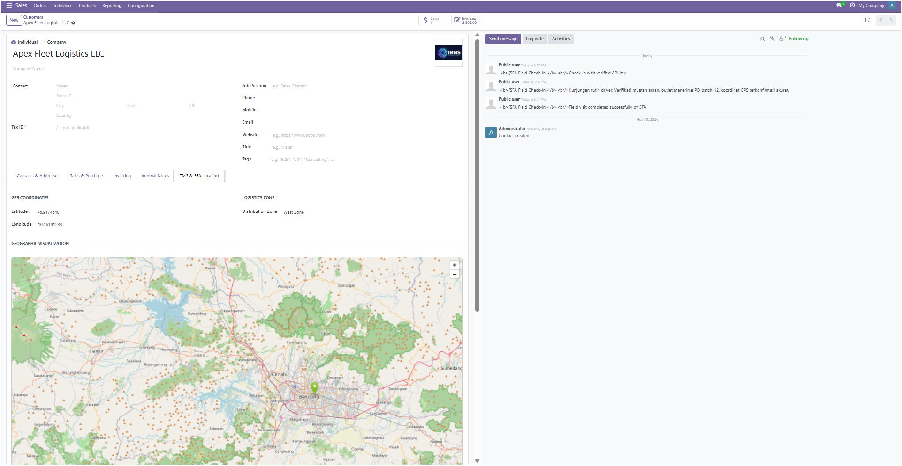
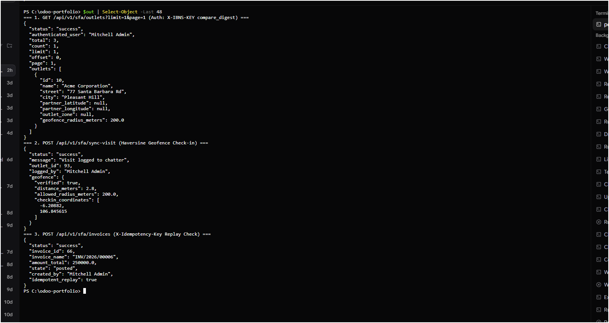
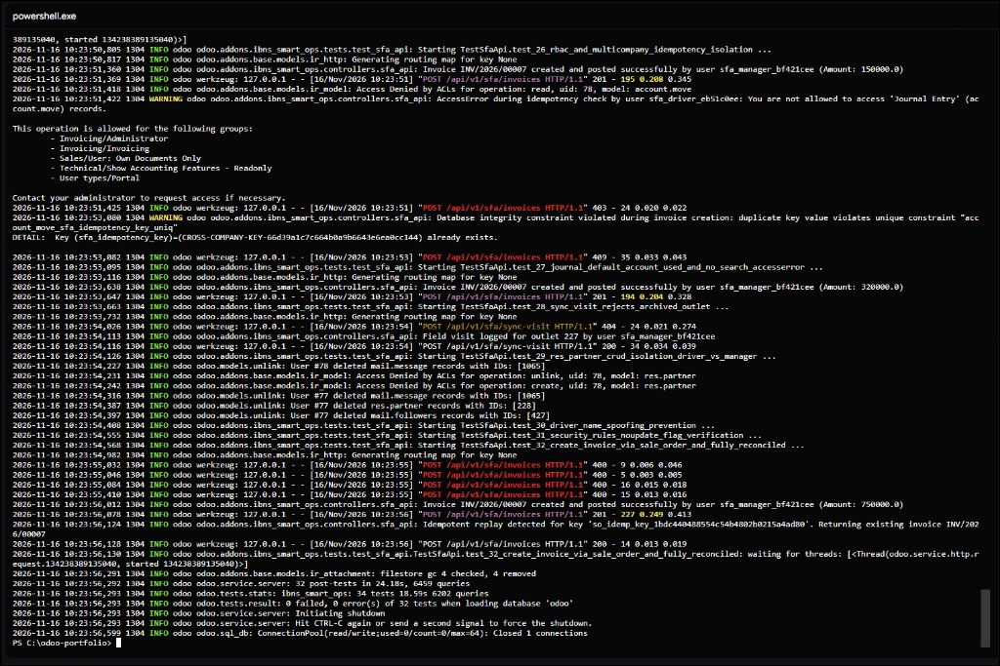

# IBNS Smart Logistics & SFA Engine (`ibns_smart_ops`)

🌐 **Language:** English | [Bahasa Indonesia](README.id.md)

[](https://github.com/ibns22-web/ibns-smart-ops/actions/workflows/ci.yml)
[](https://www.odoo.com/)
[](https://www.python.org/)
[](https://www.docker.com/)
[](https://www.postgresql.org/)
[](#-security-architecture--access-control-rbac)
[](LICENSE)

## 🎥 Technical Walkthrough & Automated Test Proof (35s)

[](https://youtu.be/3zt5PyM0UMo)

> ▶️ **[Watch Technical Demo Video (35s)](https://youtu.be/3zt5PyM0UMo)** — *Execution of 32 automated HttpCase integration tests (`0 failed`), embedded OpenStreetMap visualization, Haversine geofencing audit, and automated invoice creation (`account.move`).*

---

> **TMS & Sales Force Automation (SFA) REST API Backend Module for Odoo 18 Community.**  
> Built to streamline logistics distribution workflows, embed OpenStreetMap geospatial visualization, enforce Haversine geofence verification, audit delivery vs. billing reconciliation, and deliver stateless REST endpoints secured by Rate Guard and Role-Based Access Control (RBAC).

---

## 📌 Problem Statement & Technical Solutions

Field distribution and sales operations encounter several recurring operational challenges in standard ERP deployments:
1. **Recurring Map API Costs**: Commercial map platform quotas rapidly balloon for fleets covering thousands of retail outlets. This module renders an embedded OpenStreetMap (OSM) iframe directly inside partner form views with zero external API fees, alongside instant deep links to Google Maps navigation.
2. **JSON-RPC Limitations for Mobile Clients**: While Odoo's external `/jsonrpc` endpoint can be called statelessly, it requires RPC wrapper payloads (`execute_kw`) that leak internal ORM table and method names (`res.partner`, `account.move`, `search_read`) to client applications, while returning empty fields as boolean `false`. The REST API in this module provides an industry-standard HTTP/JSON contract (`GET`/`POST`, semantic HTTP status codes `200`/`201`/`400`/`401`/`403`/`404`/`409`/`429`, and sanitized `null` values) tailored for mobile client consumption (Flutter, React Native, iOS, Android).
3. **Lack of Physical Presence Verification (Check-in Fraud)**: Field sales representatives may record fictitious visits from home or off-route. This module enforces **Haversine formula-based geofencing** to verify whether check-in GPS coordinates fall within the registered outlet's designated radius.
4. **Duplicate Billing Risks under Unstable Networks**: In areas with poor mobile reception, client request retries can generate duplicate customer invoices. This module implements an **Idempotency Guard** via the `X-Idempotency-Key` header.
5. **Superuser Security Vulnerabilities (`.sudo()`)**: This module eliminates indiscriminate `.sudo()` calls and executes all API requests within the authenticated user's actual Odoo security context (`request.env(user=user)`), strictly enforcing Record Rules (`ir.rule`).

---

## 🏗️ Core Features & Implementation Details

### 1. OpenStreetMap Visualization (No Leaflet JS Dependency)
Outlet maps are implemented via HTML computed fields on `res.partner` ([partner_tms.py](addons/ibns_smart_ops/models/partner_tms.py)). The view embeds a static OpenStreetMap iframe computed with micro-degree bounding boxes and instant Google Maps navigation links. *Technical note: This module deliberately avoids heavy internal Leaflet.js libraries, relying instead on lightweight, self-contained standard OSM iframes with zero third-party script dependencies.*

### 2. Geofence Validation (Haversine Formula)
When field reps or drivers record a visit via `POST /api/v1/sfa/sync-visit`, the controller ingests `checkin_latitude` and `checkin_longitude`. The helper function `_calculate_haversine_distance()` computes the exact physical distance (in meters) between the check-in point and the registered outlet coordinates:
- If distance $\le$ outlet radius (`partner.geofence_radius_meters`, default 200m): The visit is marked valid and posted with a green `Geofence Verified` badge.
- If distance $>$ radius: The visit is recorded with a red `Geofence Mismatch` warning badge alongside the deviation distance on the partner chatter and API response.

### 3. Automated Delivered vs. Invoiced Audit (`stock.picking`)
The `stock.picking` model ([tms_route.py](addons/ibns_smart_ops/models/tms_route.py)) features a computed status field `delivered_vs_invoiced_status` that reconciles physical warehouse shipments against accounting records:
- `not_delivered`: Goods have not yet been dispatched and no invoice exists.
- `invoiced_pending_delivery`: A customer invoice has been issued prior to physical delivery.
- `delivered_pending_invoice`: Delivery has been completed (`done` / `delivered`), but no invoice has been posted or the invoiced quantity remains incomplete.
- `fully_reconciled`: All delivered goods are completely invoiced via posted (`posted`) accounting moves.
- `no_sale_order`: Outgoing shipment created independently without an associated Sales Order (applicable only to outgoing picking types).

### 4. Rate Guard (In-Memory Sliding Window Limiter)
Protects backend resources against client scraping, runaway retry loops, or mobile app flooding. The controller enforces a threshold of **60 requests per minute** per client IP. Requests exceeding this quota are rejected with **HTTP 429 Too Many Requests** accompanied by `Retry-After` and `X-RateLimit-*` headers.

### 5. Idempotency Guard (Duplicate Invoice Prevention)
The invoice generation endpoint `POST /api/v1/sfa/invoices` parses the `X-Idempotency-Key` or `Idempotency-Key` header. This value is stored in the unique field `sfa_idempotency_key` on `account.move`. If network retries resend an identical key, the server returns the existing invoice payload (**HTTP 200 OK**, `"idempotent_replay": true`) without creating duplicate records in PostgreSQL.

### 6. JSON Data Type Sanitization (`null` vs. `false` & Zero Coordinates)
Odoo ORM defaults empty fields to `False` and unpopulated numerical coordinates to `0.0`. The recursive helper `_sanitize_record()` normalizes boolean `False` values and empty `(0.0, 0.0)` coordinates to Python `None` (serialized as JSON `null`), producing `"street": null`, `"partner_latitude": null`, and `"partner_longitude": null`. This prevents misleading coordinate plots to Null Island (0°N, 0°E in the Atlantic Ocean) and eliminates deserialization crashes on strictly-typed mobile clients.

### 7. Stateless REST (`save_session=False`)
All controller endpoints are decorated with `save_session=False`, ensuring Odoo does not write session files to disk or transmit `Set-Cookie: session_id=...` headers.

---

## 📸 Screenshots & Interface Verification

### 1. Odoo Backend Interface & REST API Responses
| Visualisasi Peta Outlet & Geofence (Odoo Form) | Pengujian Endpoint REST API & JSON Payload |
|:---:|:---:|
|  |  |
| *Embedded OpenStreetMap iframe with GPS coordinates, geofence radius, and Google Maps integration* | *SFA REST API execution test, geofence verified JSON response, and authenticated user attribution* |

### 2. Automated Test Suite Execution (32 Tests Pass)

*Execution of all 32 integration test suites (HttpCase) in Odoo 18: 0 failed, 0 errors (100% passing).*

---

## 🛡️ Security Architecture & Access Control (RBAC)

```
┌─────────────────────────────────────────────────────────────┐
│                 Mobile / SFA External Client                │
└──────────────┬───────────────────────────────▲──────────────┘
               │ HTTPS + Bearer <api_key> /    │ JSON
               │ X-IBNS-KEY: <api_key>         │
               ▼                               │
┌──────────────────────────────────────────────┴──────────────┐
│                  SFA API Request Pipeline                   │
├─────────────────────────────────────────────────────────────┤
│  1. Rate Guard: Sliding Window (Max 60 req/min)             │
│  2. JSON Sanitizer: Strict syntax validation (Reject Bad)   │
│  3. Token Resolver: Odoo Native API Keys (res.users.apikeys)│
│     or configured System Parameters (ir.config_param)       │
│  4. User Context: request.env(user=authenticated_user)      │
│  5. NO SUPERUSER BYPASS (.sudo() eliminated)                │
├─────────────────────────────────────────────────────────────┤
│                 Odoo 18 Security Framework                  │
├──────────────────────────────┬──────────────────────────────┤
│    ACLs (ir.model.access)    │     Record Rules (ir.rule)   │
│  • Group SFA User / Driver   │  • Driver: Assigned Pickings │
│    (Read/Write, No Unlink)   │  • Manager: Global Access    │
│  • Group SFA Manager (Admin) │  • Multi-Company Isolation   │
└──────────────────────────────┴──────────────────────────────┘
```

### User Group Access Permissions
- **`ibns_smart_ops.group_sfa_user` (Field Sales / Drivers)**:
  - Can read outlet records and view delivery routes assigned to their specific account via foreign key relation isolation `driver_id = user.id` (`Many2one('res.users')`).
  - Can post visit check-in chatter notes on partner records.
  - **Strictly prohibited from unlinking records (`perm_unlink = 0`) and prohibited from creating invoices**. Requests to the invoice endpoint are automatically rejected with **HTTP 403 Forbidden**.
- **`ibns_smart_ops.group_sfa_manager` (Logistics & Operations Managers)**:
  - Full administrative access to dispatch scheduling, invoice creation, and module system configurations.

### Audit Trail (Real User Attribution)
Every check-in log and invoice creation is attributed directly to the authenticating Odoo user record (`res.users`), ensuring end-to-end accountability within Odoo's mail chatter and financial audit logs.

---

## 📡 API Reference

### Authentication & Idempotency Headers
All SFA endpoints accept two authentication header variations:

```http
Authorization: Bearer <YOUR_SFA_API_KEY>
```
*or*
```http
X-IBNS-KEY: <YOUR_SFA_API_KEY>
```

#### Idempotency Header Semantics (`X-Idempotency-Key`)
The `X-Idempotency-Key` header is **optional yet strongly recommended** for data-mutating endpoints such as invoice creation (`POST /api/v1/sfa/invoices`):
```http
X-Idempotency-Key: <UNIQUE_CLIENT_UUID>
Content-Type: application/json
```
*(The controller also recognizes the `Idempotency-Key` header or the JSON payload property `idempotency_key`).*

- **When Provided**: The server binds the client UUID to the PostgreSQL record (`sfa_idempotency_key`, `UNIQUE`). In the event of network timeouts or dropped connections where the client issues a retry, no duplicate invoice is generated; the server safely replays the previously created invoice payload with **HTTP 200 OK** and flag `"idempotent_replay": true`.
- **When Omitted**: The request proceeds normally to create a fresh invoice (**HTTP 201 Created**) with `sfa_idempotency_key = null`, but client retries will forfeit deduplication guarantees under unstable network conditions.

---

### 1. GET `/api/v1/sfa/outlets`
Retrieves a paginated list of active customer outlets, complete with GPS coordinates, geofence radius thresholds, and logistical distribution zones.

#### Query Parameters (Optional)
- `limit` *(integer)*: Maximum number of records per page (default: `50`, max: `200`).
- `offset` *(integer)*: Starting record index offset (default: `0`).
- `page` *(integer)*: 1-based page index (e.g., `page=2` with `limit=50` automatically resolves to `offset=50`).
- `outlet_zone` *(string)*: Filter outlets by logistics distribution zone (`north`, `south`, `east`, `west`).

#### Example Request (cURL via X-IBNS-KEY)
```bash
curl -X GET "http://localhost:8069/api/v1/sfa/outlets?limit=50&page=1" \
     -H "X-IBNS-KEY: <YOUR_SFA_API_KEY>"
```

#### Success Response (200 OK)
```json
{
  "status": "success",
  "authenticated_user": "Budi Santoso",
  "total": 1,
  "count": 1,
  "limit": 50,
  "offset": 0,
  "page": 1,
  "outlets": [
    {
      "id": 7,
      "name": "Apex Fleet Logistics Center",
      "street": "Kawasan Industri MM2100 Blok C-12",
      "city": "Bekasi",
      "partner_latitude": -6.2088000,
      "partner_longitude": 106.8456000,
      "geofence_radius_meters": 200.0,
      "outlet_zone": "east"
    }
  ]
}
```

---

### 2. POST `/api/v1/sfa/sync-visit`
Logs a field visit check-in to partner chatter with automated Haversine geofence verification.

#### Example Request (cURL)
```bash
curl -X POST "http://localhost:8069/api/v1/sfa/sync-visit" \
     -H "Content-Type: application/json" \
     -H "X-IBNS-KEY: <YOUR_SFA_API_KEY>" \
     -d '{
       "outlet_id": 7,
       "checkin_latitude": -6.208820,
       "checkin_longitude": 106.845615,
       "notes": "Pengecekan display rak toko dan konfirmasi pesanan repeat order."
     }'
```

#### Success Response (200 OK - Inside Geofence)
```json
{
  "status": "success",
  "message": "Visit logged to chatter",
  "outlet_id": 7,
  "logged_by": "Budi Santoso",
  "geofence": {
    "verified": true,
    "distance_meters": 2.7,
    "allowed_radius_meters": 200.0,
    "checkin_coordinates": [-6.208820, 106.845615]
  }
}
```

---

### 3. POST `/api/v1/sfa/invoices`
Creates and posts customer invoices (`account.move`, `move_type='out_invoice'`) atomically. Protected by Idempotency Guard (via `X-Idempotency-Key` header or `idempotency_key` payload property) and strict multi-company boundary validation.

Supports **2 Operational Modes**:
1. **Sales Order Mode (`sale_order_id`)**: Automatically generates multi-line customer invoices from an existing sales order (`sale_order._create_invoices()`), binds the order reference, and automatically transitions the delivery audit status (`delivered_vs_invoiced_status`) on related delivery pickings (`stock.picking`) to **`fully_reconciled`**.
2. **Ad-hoc Summary Mode (`amount` & `description`)**: For instant on-the-spot field settlement without a pre-existing sales order.

#### Request Payload Specification (JSON Body)
- `partner_id` *(integer, required)*: Odoo customer partner ID (`res.partner`). Boolean types are rejected (HTTP 400).
- `sale_order_id` *(integer, optional)*: Odoo Sales Order ID (`sale.order`). Boolean types are rejected (HTTP 400). Must belong to the specified `partner_id`.
- `amount` *(float, required if `sale_order_id` is omitted)*: Net invoice amount. Must be a finite number greater than zero ($\text{amount} > 0$). `NaN`, `inf`, `-inf`, or $\le 0$ are rejected (HTTP 400). If `sale_order_id` is provided, `amount` is optional since totals derive directly from sales order lines.
- `description` *(string, optional)*: Line item description for ad-hoc invoices (default: `"SFA Field Invoice"`).
- `idempotency_key` *(string, optional)*: Alternative idempotency key passed within the JSON body if client environments cannot set custom HTTP headers.

#### Example Request A - Based on Sales Order (Auto-Reconcile Picking)
```bash
curl -X POST "http://localhost:8069/api/v1/sfa/invoices" \
     -H "Content-Type: application/json" \
     -H "Authorization: Bearer <YOUR_SFA_API_KEY>" \
     -H "X-Idempotency-Key: sfa_so_invoice_uuid_9921" \
     -d '{
       "partner_id": 7,
       "sale_order_id": 42
     }'
```

#### Example Request B - Ad-hoc Field Settlement
```bash
curl -X POST "http://localhost:8069/api/v1/sfa/invoices" \
     -H "Content-Type: application/json" \
     -H "Authorization: Bearer <YOUR_SFA_API_KEY>" \
     -H "X-Idempotency-Key: sfa_batch_4412_uuid" \
     -d '{
       "partner_id": 7,
       "amount": 250000.0,
       "description": "Pelunasan Pengiriman SFA Batch 1"
     }'
```

#### Success Response (201 Created - New Invoice Posted)
```json
{
  "status": "success",
  "invoice_id": 14,
  "invoice_name": "INV/2026/00014",
  "amount_total": 250000.0,
  "state": "posted",
  "created_by": "Manajer Logistik",
  "idempotent_replay": false
}
```

#### Success Response (200 OK - Idempotent Replay)
If an identical `X-Idempotency-Key` is replayed:
```json
{
  "status": "success",
  "invoice_id": 14,
  "invoice_name": "INV/2026/00014",
  "amount_total": 250000.0,
  "state": "posted",
  "created_by": "Manajer Logistik",
  "idempotent_replay": true
}
```

#### Standard Error Responses
- **400 Bad Request (Non-Finite Number: NaN / Infinity / $\le$ 0)**:
  `{"status": "error", "message": "amount must be a finite number greater than zero"}`
- **400 Bad Request (Validation / Relationship Failure)**:
  `{"status": "error", "message": "Sale order does not belong to the specified partner"}` or `{"status": "error", "message": "Malformed JSON in request body"}`
- **401 Unauthorized (Missing or Invalid Token)**:
  `{"status": "error", "message": "Unauthorized: Invalid or inactive API key"}`
- **403 Forbidden (RBAC Access Violation)**:
  `{"status": "error", "message": "Forbidden: Insufficient permissions to create or post invoices"}`
- **404 Not Found (Resource / Outlet Not Found or Archived)**:
  `{"status": "error", "message": "Outlet not found or archived"}` *(validated in test_08 & test_28)*
- **409 Conflict (Cross-Company Idempotency Key Collision / Database Constraint Violation)**:
  `{"status": "error", "message": "Idempotency key collision or database constraint violated"}` *(validated in test_26)*
- **429 Too Many Requests (Rate Guard Limit Exceeded)**:
  `{"status": "error", "message": "Too Many Requests: Rate limit of 60 req/min exceeded. Retry after 45s."}`
- **500 Internal Server Error (Masked Safe Response)**:
  `{"status": "error", "message": "Internal server error"}`

---

## 🚀 Installation & Deployment Guide

### 1. Copy Environment Configuration
Copy the environment secret template to `.env` and the Odoo configuration template to `config/odoo.conf` (both files are protected by `.gitignore`):
```bash
cp .env.example .env
cp config/odoo.conf.template config/odoo.conf
```
- **Database**: Adjust database credentials (`DB_USER`, `DB_PASSWORD`, `DB_NAME=odoo`) in `.env`.
- **Master Password**: Odoo reads the database master password directly from `config/odoo.conf` (the `admin_passwd` parameter). The template provides a default development value `admin_passwd = admin_dev_password`. Change this value before deploying to production.
- **Reverse Proxy (`proxy_mode`)**: `config/odoo.conf.template` has `proxy_mode = True` enabled by default so that the Werkzeug `ProxyFix` middleware accurately recognizes `X-Forwarded-For` headers behind reverse proxies (Nginx, Traefik, or Cloudflare), ensuring **Rate Guard** limits client IPs with precision.

### 2. Launch Docker Stack
Start the containerized Odoo and PostgreSQL stack:
```bash
docker compose up -d
```
*Note: The web container is standardized as `ibns_smart_ops_web` in `docker-compose.yml`, accessible via `docker compose exec web ...`.*

### 3. Initialize & Install Module `ibns_smart_ops`
Use the **`-i`** (*init/install*) flag when installing the module for the first time on a fresh database (default database: `odoo`), specifying `--http-port=8070` to prevent port binding collisions (*Address already in use*) with Odoo's primary process on port 8069:
```bash
docker compose exec web /entrypoint.sh odoo -d odoo --http-port=8070 -i ibns_smart_ops --stop-after-init
docker compose restart web
```
*(Replace `odoo` with your target database name if using a custom `DB_NAME` in `.env`).*

> **Important notes on Odoo CLI flags:**
> - Use **`-i ibns_smart_ops`** for **initial installation** of a new module. (Using `-u` on an uninstalled module will not trigger installation).
> - Use **`-u ibns_smart_ops`** only for **code upgrades** after the module has already been installed.

### 4. Access Web Interface
Open your browser and navigate to:
```
http://localhost:8069
```

### 5. First-Time API Key Generation & Setup
To prevent cURL calls in the API Reference from failing with **HTTP 401 Unauthorized**, configure an API key via either of the following methods:

#### Option A - Generate Odoo Native User API Key (Real User / Role-based — Strongly Recommended)
This method binds tokens directly to an authenticating Odoo user record, ensuring full audit trail attribution on visit check-ins and invoice moves:
1. Open `http://localhost:8069` and log in with an authorized user (e.g., a user belonging to `ibns_smart_ops.group_sfa_manager` or Administrator).
2. Click your profile avatar/name in the top-right corner, then select **Preferences** (or **My Profile**).
3. Switch to the **Account Security** tab.
4. Under the **API Keys** section, click **New API Key**.
5. Enter your account password when prompted, provide a key description (e.g., `SFA Mobile Production`), and click **Generate Key**.
6. Copy the displayed API key (shown only once). Include this key in your request headers:
   ```bash
   -H "Authorization: Bearer <API_KEY>"
   # or
   -H "X-IBNS-KEY: <API_KEY>"
   ```

#### Option B - Use System Integration Secret Key (Machine-to-Machine)
For headless backend-to-backend integrations without interactive user accounts:
1. Define a secret token in `.env` before booting Docker:
   ```env
   SFA_API_SECRET_KEY=<YOUR_SECURE_RANDOM_TOKEN>
   ```
2. Or configure the system parameter in the Odoo backend under **Settings ➔ Technical ➔ Parameters ➔ System Parameters** *(Developer Mode must be activated first)* with key `ibns_smart_ops.sfa_api_key`.
3. API calls authenticated with this token are automatically attributed to the technical service user `user_sfa_api_service`.

---

## 🧪 Automated Test Suite Execution Guide

This module is accompanied by a **32 integration test suite** executed automatically via Odoo's `HttpCase` test runner ([test_sfa_api.py](addons/ibns_smart_ops/tests/test_sfa_api.py)).

### 1. Run Complete Test Suite
Execute the following command in your terminal:
```bash
docker compose exec web /entrypoint.sh odoo -d odoo --http-port=8070 -i ibns_smart_ops --test-enable --stop-after-init --log-level=test
```

### 2. Run SFA API Tests Specifically (Post-Install)
To execute the module API test suite in isolation:
```bash
docker compose exec web /entrypoint.sh odoo -d odoo --http-port=8070 --test-tags=/ibns_smart_ops --test-enable --stop-after-init
```

### 3. Validated Test Coverage Scenarios
1. `test_01`: Request rejection without authentication tokens across all endpoints (HTTP 401).
2. `test_02`: Rejection of invalid, expired, or non-ASCII/Unicode token strings across both Bearer and `X-IBNS-KEY` headers with HTTP 401 (preventing unhandled HTTP 500 errors).
3. `test_03`: Successful authentication using custom `X-IBNS-KEY` header (HTTP 200).
4. `test_04`: Successful authentication using standard `Authorization: Bearer` header (HTTP 200).
5. `test_05`: **Invoice & Journal Items Audit**: Verifies double-entry ledger balance, total debit == total credit, receivable line presence, and revenue account mapping.
6. `test_06`: **Malformed JSON & Bad Input Handling**: Rejection of truncated JSON syntax, non-object JSON bodies, malformed IDs, and nonexistent partners (HTTP 400).
7. `test_07`: **Finite Number Validation**: Strict rejection of `NaN`, `Infinity`, `-Infinity`, zero, and negative invoice amounts (HTTP 400).
8. `test_08`: **Check-in Input Validation**: Rejection of missing, malformed, or nonexistent/archived `outlet_id` on `/api/v1/sfa/sync-visit` (HTTP 400 & HTTP 404).
9. `test_09`: **Haversine Geofencing & Chatter Markup**: Physical GPS distance calculation (in-geofence verified vs. out-of-geofence alert) and HTML chatter formatting.
10. `test_10`: **Driver Role Boundary (RBAC)**: Confirms drivers can read outlets and record check-ins, but are strictly blocked with HTTP 403 Forbidden when attempting to create invoices.
11. `test_11`: **Driver Record Rules Isolation & Courier Sync**: Verifies Record Rule isolation via foreign key `driver_id = user.id` (`Many2one('res.users')`) ensuring drivers only access their assigned pickings and stock moves, other drivers are filtered out, managers retain global visibility, and `driver_name` auto-synchronizes or clears on reassignment and unassignment via ORM and form UI onchange.
12. `test_12`: **Idempotency Replay**: Confirms `X-Idempotency-Key` prevents duplicate invoice creation on network retries (HTTP 200 replay).
13. `test_13`: **Empty Field Sanitization**: Verifies empty Odoo values are serialized as JSON `null` (rather than boolean `false`).
14. `test_14`: **Delivered vs Invoiced Audit**: Explicitly tests all five `delivered_vs_invoiced_status` states on `stock.picking` (`no_sale_order`, `not_delivered`, `invoiced_pending_delivery`, `delivered_pending_invoice`, and `fully_reconciled`), ensuring incoming receipts (`incoming`) are safely excluded (`False`).
15. `test_15`: **Odoo 18 Chatter Fallback**: Verifies `email_from` fallback (`noreply@ibns.local`) when users lack a configured work email, preventing mail delivery `UserError`.
16. `test_16`: **Rate Guard In-Memory Cleanup**: Verifies eviction of expired timestamps (> 60s) to guarantee zero memory leakage over time.
17. `test_17`: **Idempotency SQL Constraint**: Verifies PostgreSQL database-level race condition protection against duplicate invoice keys via `UNIQUE (sfa_idempotency_key)`.
18. `test_18`: **Outlet Endpoint Pagination**: Validates `limit` and `offset` query parameters on `GET /api/v1/sfa/outlets`.
19. `test_19`: **Outlet Zone Flexibility**: Verifies new partner records default cleanly without forcing unwanted delivery zones (*unassigned* flexibility).
20. `test_20`: **Rate Guard Throttling (HTTP 429)**: Rejection of the 61st request within 60s per client IP, verifying the presence of `Retry-After` headers.
21. `test_21`: **Concurrent Idempotency Race Handling**: Validates race condition handling when duplicate requests arrive concurrently; `IntegrityError` is safely caught, transactions rolled back, and existing invoices returned as HTTP 200 replay (preventing HTTP 500).
22. `test_22`: **Multi-Company & Allowed Companies**: Validates multi-company isolation across outlet retrieval, visit check-ins, and invoice generation, matching Company B journals without triggering *Incompatible companies* errors.
23. `test_23`: **Boolean Type Coercion Rejection**: Verifies explicit rejection of boolean values (`true`/`false`) on numeric parameters (`outlet_id`, `partner_id`, `amount`) with HTTP 400 to prevent Python coercion vulnerabilities (`int(True) == 1`).
24. `test_24`: **Automatic Tax Exclusion**: Verifies API invoice generation explicitly excludes auto-applied sales taxes (`tax_ids: [(5, 0, 0)]`), ensuring `amount_total` exactly matches the client-submitted payload without tax inflation.
25. `test_25`: **Strict Check-in Coordinate Validation**: Validates that non-numeric GPS coordinates (strings, `NaN`/`inf`, booleans, out-of-range WGS84 coordinates, or partial latitudes) are rejected with HTTP 400 rather than silently bypassed.
26. `test_26`: **Idempotency RBAC & Multi-Company Isolation**: Verifies `.sudo()` elimination on idempotency lookups; drivers lacking billing privileges receive HTTP 403 when attempting to replay invoice keys, and cross-company key collisions return HTTP 409 Conflict without leaking other entities' invoice data.
27. `test_27`: **Sales Journal Account Integrity**: Verifies invoice creation directly binds `default_account_id` from the target sales journal rather than executing arbitrary account searches, preventing *AccessError* and ensuring legitimate revenue accounting.
28. `test_28`: **Archived Outlet Visit Rejection**: Verifies visit check-in endpoints reject attempts to check into inactive or archived outlets (`active=False`) with HTTP 404 Not Found.
29. `test_29`: **Partner CRUD Permission Isolation**: Validates ACL constraints preventing drivers from creating or deleting partner records (triggering *AccessError*) while allowing operational updates, whereas managers possess full privileges.
30. `test_30`: **Driver Name Spoofing Prevention**: Verifies Record Rule enforcement on foreign key `driver_id = user.id` (`Many2one('res.users')`); shipments with plain text `driver_name` cannot be hijacked by unassigned drivers, and user profile modifications cannot compromise another driver's tasks.
31. `test_31`: **Security Rules noupdate Flag Verification**: Verifies all module `ir.rule` records maintain `noupdate=False` so that module upgrades (`-u`) reliably update security policies, while protected integration accounts remain shielded (`noupdate=True`).
32. `test_32`: **Sales Order Invoicing & Auto-Reconciliation**: Verifies invoice generation via `sale_order_id` (including strict rejection of booleans, non-integers, missing IDs, and partner mismatches), automated multi-line invoice creation via `sale_order._create_invoices()`, auto-posting with `sfa_idempotency_key` persistence, and automatic reconciliation of picking `delivered_vs_invoiced_status` to `fully_reconciled`.

---

## ⚠️ Architectural Boundaries & Known Limitations

The following design decisions and architectural trade-offs should be kept in mind for production deployments and future expansion:
- **In-Memory Rate Guard in Multi-Worker Environments**: The sliding window rate limiter stores timestamps in local Python process memory. In production clusters with `workers > 1` in `odoo.conf`, quotas are evaluated per worker process; high-traffic multi-node architectures should supplement this with reverse proxy rate limiting (Nginx `limit_req_zone` / Cloudflare) or a centralized Redis tier.
- **Foreign Key Courier Assignment (`driver_id`)**: Courier assignment and Record Rules on `stock.picking` and `stock.move` enforce foreign key relation isolation `driver_id = user.id` (`Many2one('res.users')`) to prevent profile spoofing, while the legacy text field `driver_name` is automatically synchronized for backward compatibility.
- **API Invoicing Flexibility**: Endpoint `POST /api/v1/sfa/invoices` supports two workflows: (1) full automated multi-line invoice generation via `sale_order_id` leveraging Odoo's native `sale.order._create_invoices()` engine which automatically reconciles delivery pickings, or (2) ad-hoc single-line summary invoices (`amount` and `description`) for on-the-spot field collections (without itemized SKU lines).
- **Static Map Previews via OpenStreetMap Iframe**: Relies on calculated OSM HTML iframes to remain 100% free of external API licensing fees and lightweight, rather than incorporating interactive JavaScript OWL (Odoo Web Library) widgets.

---

## 📂 Module File Structure

```
addons/ibns_smart_ops/
├── __init__.py
├── __manifest__.py              # Module metadata, dependencies, security & view definitions
├── controllers/
│   ├── __init__.py
│   └── sfa_api.py               # REST API: Rate Guard, Geofencing, RBAC auth, Idempotency, Chatter
├── models/
│   ├── __init__.py
│   ├── partner_tms.py           # Inherit res.partner: GPS, geofence radius, OSM preview iframe
│   ├── tms_route.py             # Inherit stock.picking: route status & Delivered vs Invoiced audit
│   ├── account_move.py          # Inherit account.move: sfa_idempotency_key with PostgreSQL UNIQUE constraint
│   └── res_config_settings.py   # Token & integration user configuration in Odoo Settings
├── security/
│   ├── sfa_security.xml         # Security Groups, Record Rules (ir.rule), Technical User with email
│   └── ir.model.access.csv      # ACL model access per group (no unrestricted unlink)
├── tests/
│   ├── __init__.py
│   └── test_sfa_api.py          # 32 HttpCase test suites (Rate limit, Geofence, Idempotency, RBAC, Chatter)
└── views/
    ├── account_move_views.xml   # Inherited account.move form view displaying sfa_idempotency_key in Accounting Info
    ├── delivery_route_views.xml # Form & list inherit stock.picking: TMS tab & Delivered vs Invoiced badge
    ├── partner_tms_views.xml    # Form inherit res.partner: TMS Geofence tab & embedded OSM map widget
    └── res_config_settings_views.xml # Backend settings configuration view
```

---

## 👨‍💻 Contributors & License

Developed by **IBNS Engineering**.  
Software License: [LGPL-3](LICENSE).
