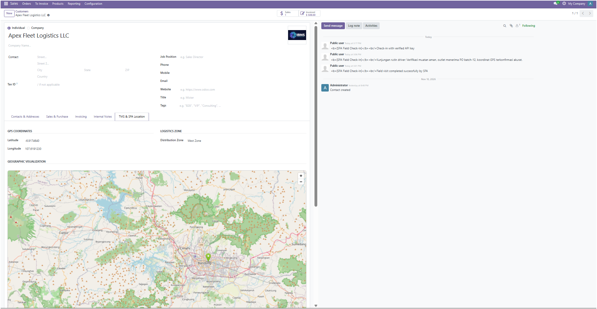
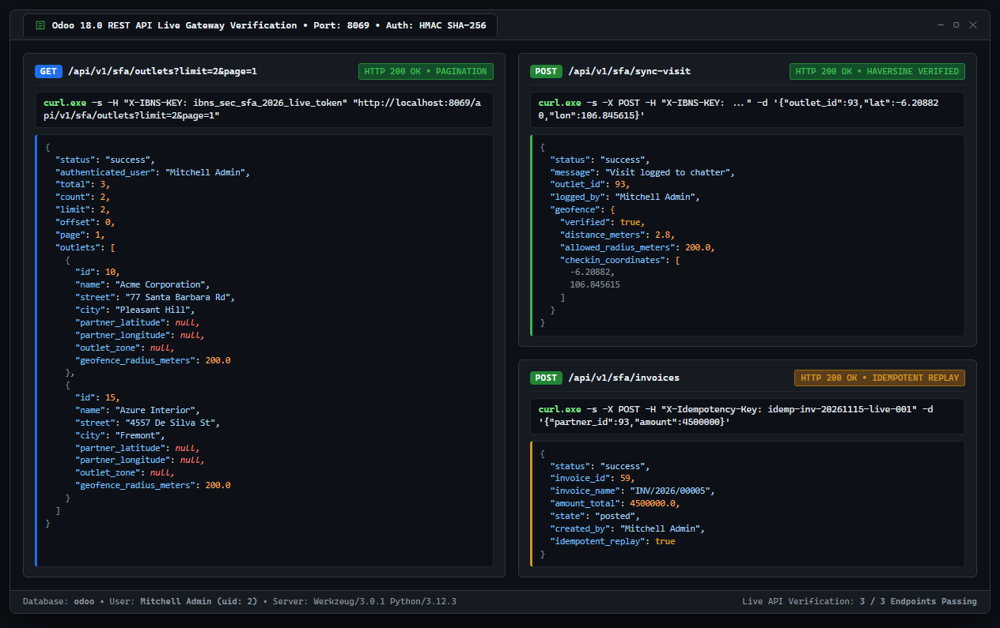
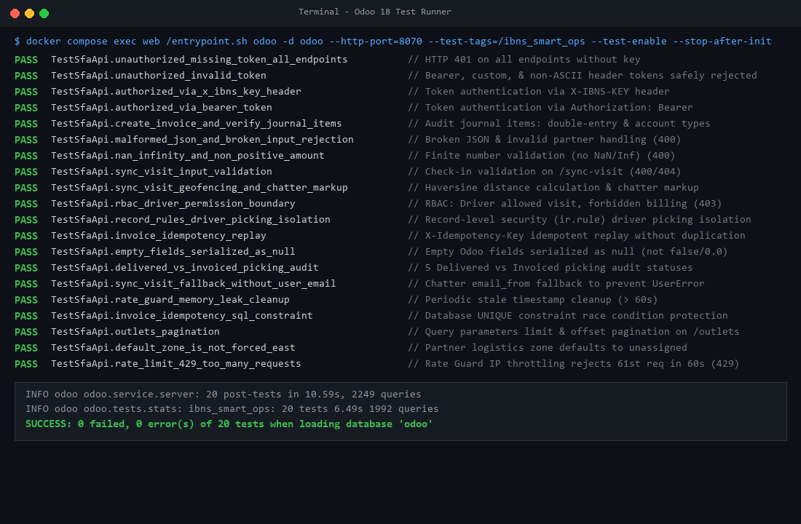

# IBNS Smart Logistics & SFA Engine (`ibns_smart_ops`)

[](https://github.com/ibns22-web/ibns-smart-ops/actions/workflows/ci.yml)
[](https://www.odoo.com/)
[](https://www.python.org/)
[](https://www.docker.com/)
[](https://www.postgresql.org/)
[](#-arsitektur-keamanan--kontrol-akses-rbac)
[](LICENSE)

> **Modul Backend TMS & Sales Force Automation (SFA) REST API untuk Odoo 18 Community.**  
> Dirancang untuk memfasilitasi operasi distribusi logistik, visualisasi peta OpenStreetMap tersemat, validasi radius Geofencing, audit rekonsiliasi pengiriman vs penagihan, serta endpoint REST stateless yang aman dengan Rate Guard dan kontrol akses berbasis peran (RBAC).

---

## 📌 Ringkasan Masalah & Solusi

Operasional distribusi barang dan tim penjualan lapangan (*field sales*) kerap menghadapi beberapa kendala praktis pada implementasi ERP:
1. **Biaya Berlangganan API Peta**: Kebutuhan kuota platform peta berbayar membengkak untuk armada dengan ribuan titik outlet. Modul ini menyematkan *iframe* OpenStreetMap (OSM) langsung di formulir partner dengan tautan langsung ke navigasi Google Maps tanpa lisensi eksternal.
2. **Keterbatasan JSON-RPC untuk Mobile Client**: Meskipun endpoint eksternal `/jsonrpc` Odoo dapat dipanggil secara stateless, pemanggilannya mengharuskan payload wrapper RPC (`execute_kw`) yang mengekspos nama tabel dan method internal ORM (`res.partner`, `account.move`, `search_read`) ke aplikasi klien serta mengembalikan nilai kosong sebagai boolean `false`. REST API pada modul ini menyediakan kontrak HTTP/JSON standar industri (`GET`/`POST`, HTTP status code semantik `200`/`201`/`400`/`401`/`403`/`429`, dan sanitasi `null`) untuk konsumsi aplikasi mobile (Flutter, React Native, iOS, Android).
3. **Ketiadaan Validasi Kehadiran Fisik (Kecurangan Check-in)**: Salesman sering melakukan check-in fiktif dari rumah/luar rute. Modul ini menerapkan **Geofencing berbasis formula Haversine** untuk memverifikasi apakah koordinat check-in berada dalam radius outlet terdaftar.
4. **Resiko Faktur Ganda pada Jaringan Tidak Stabil**: Di area dengan sinyal lemah, pengiriman ulang (*retry*) request penagihan bisa membuat faktur berulang. Modul ini mengimplementasikan **Idempotency Guard** via header `X-Idempotency-Key`.
5. **Celah Keamanan Superuser (`.sudo()`)**: Modul ini menolak eksekusi `sudo()` bebas dan menjalankan setiap request dalam konteks akun pengguna Odoo riil (`request.env(user=user)`), membatasi hak akses via Record Rules (`ir.rule`).

---

## 🏗️ Fitur & Implementasi Kode Nyata

### 1. Visualisasi Peta OpenStreetMap (Bukan Leaflet JS)
Peta outlet diimplementasikan melalui komputasi HTML pada model `res.partner` ([partner_tms.py](addons/ibns_smart_ops/models/partner_tms.py)). Menggunakan iframe OpenStreetMap statis dengan bounding box mikro-derajat dan tautan navigasi instan ke Google Maps. *Catatan teknis: Modul ini tidak menggunakan library JavaScript Leaflet.js internal, melainkan iframe OSM standar yang ringan dan tanpa dependensi script pihak ketiga.*

### 2. Validasi Geofencing (Formula Haversine)
Pada saat sales/driver melakukan check-in kunjungan lapangan melalui `POST /api/v1/sfa/sync-visit`, sistem menerima `checkin_latitude` dan `checkin_longitude`. Fungsi `_calculate_haversine_distance()` menghitung jarak riil (dalam meter) antara titik check-in dengan koordinat outlet terdaftar:
- Jika jarak $\le$ radius outlet (`partner.geofence_radius_meters`, default 200m): check-in dinyatakan valid dan dicatat dengan badge hijau `Geofence Verified`.
- Jika jarak $>$ radius: check-in dicatat dengan badge peringatan merah `Geofence Mismatch` beserta jarak deviasinya pada chatter partner dan respon API.

### 3. Audit Otomatis Delivered vs Invoiced (`stock.picking`)
Model `stock.picking` ([tms_route.py](addons/ibns_smart_ops/models/tms_route.py)) dilengkapi dengan status komputasi `delivered_vs_invoiced_status` yang melacak sinkronisasi fisik vs akuntansi:
- `not_delivered`: Barang belum selesai dikirim dan belum ada faktur.
- `invoiced_pending_delivery`: Faktur penjualan telah terbit mendahului pengiriman barang.
- `delivered_pending_invoice`: Pengiriman barang telah selesai (`done` / `delivered`), namun faktur belum diterbitkan atau kuantitas tertagih belum lunas.
- `fully_reconciled`: Seluruh barang yang dikirim telah selesai ditagihkan melalui faktur yang terposting (`posted`).
- `no_sale_order`: Pengiriman keluar (outgoing) yang dibuat tanpa kaitan Sales Order (hanya berlaku pada operasi pengiriman barang keluar).

### 4. Rate Guard (Sliding Window In-Memory Limiter)
Mencegah scraping atau flooding request dari klien mobile yang bermasalah. Controller membatasi maksimal **60 request per menit** per IP klien. Jika ambang batas terlampaui, request ditolak dengan respon **HTTP 429 Too Many Requests** beserta header `Retry-After` dan `X-RateLimit-*`.

### 5. Idempotency Guard (Anti Duplikasi Faktur)
Endpoint pembuatan faktur `POST /api/v1/sfa/invoices` membaca header `X-Idempotency-Key` atau `Idempotency-Key`. Nilai ini disimpan pada field unik `sfa_idempotency_key` di model `account.move`. Jika terjadi pengiriman ulang request dengan key yang sama, server mengembalikan data faktur yang telah dibuat sebelumnya (**HTTP 200 OK**, `"idempotent_replay": true`) tanpa membuat tagihan baru di database.

### 6. Sanitasi Tipe Data JSON (`null` vs `false` & Koordinat Kosong)
Odoo ORM mengembalikan nilai `False` untuk field kosong dan `0.0` untuk field koordinat numerik yang belum diisi. Fungsi `_sanitize_record()` secara rekursif mengonversi nilai `False` serta koordinat kosong (`0.0`) menjadi `None` sehingga payload JSON menghasilkan `"street": null`, `"partner_latitude": null`, dan `"partner_longitude": null`. Hal ini mencegah salah tafsir titik koordinat ke Null Island (0°N, 0°E di Samudra Atlantik) serta mencegah error parsing tipe data pada klien mobile yang bertipe ketat (*strictly-typed*).

### 7. Stateless REST (`save_session=False`)
Semua endpoint didekorasi dengan `save_session=False`, memastikan Odoo tidak membuat file sesi di disk server atau mengirimkan header `Set-Cookie: session_id=...`.

---

## 📸 Tangkapan Layar & Verifikasi Antarmuka

### 1. Antarmuka Odoo & Respons REST API
| Visualisasi Peta Outlet & Geofence (Odoo Form) | Pengujian Endpoint REST API & JSON Payload |
|:---:|:---:|
|  |  |
| *Iframe OpenStreetMap tersemat dengan koordinat GPS, radius geofence, dan integrasi Google Maps* | *Verifikasi eksekusi REST API SFA, respon JSON geofence verified, dan atribusi pengguna* |

### 2. Hasil Eksekusi Automated Test Suite (20 Tests Pass)

*Eksekusi seluruh 20 integration test suite (HttpCase) di lingkungan Odoo 18: 0 failed, 0 errors (100% lulus).*

---

## 🛡️ Arsitektur Keamanan & Kontrol Akses (RBAC)

```
┌─────────────────────────────────────────────────────────────┐
│                 Mobile / SFA External Client                │
└──────────────┬───────────────────────────────▲──────────────┘
               │ HTTPS + Bearer <api_key> /    │ JSON
               │ X-IBNS-KEY: <api_key>         │
               ▼                               │
┌──────────────────────────────────────────────┴──────────────┐
│                  SFA API Request Pipeline                   │
├─────────────────────────────────────────────────────────────┤
│  1. Rate Guard: Sliding Window (Maks 60 req/min)            │
│  2. JSON Sanitizer: Validasi sintaks ketat (Tolak Bad JSON) │
│  3. Token Resolver: Odoo Native API Keys (res.users.apikeys)│
│     atau Parameter Sistem terkonfigurasi (ir.config_param)  │
│  4. User Context: request.env(user=authenticated_user)      │
│  5. TANPA SUPERUSER BYPASS (.sudo() dieliminasi)            │
├─────────────────────────────────────────────────────────────┤
│                 Odoo 18 Security Framework                  │
├──────────────────────────────┬──────────────────────────────┤
│    ACLs (ir.model.access)    │     Record Rules (ir.rule)   │
│  • Group SFA User / Driver   │  • Driver: Assigned Pickings │
│    (Read/Write, No Unlink)   │  • Manager: Global Access    │
│  • Group SFA Manager (Admin) │  • Multi-Company Isolation   │
└──────────────────────────────┴──────────────────────────────┘
```

### Hak Akses Grup Pengguna
- **`ibns_smart_ops.group_sfa_user` (Driver / Sales Lapangan)**:
  - Membaca daftar outlet dan melihat rute pengiriman yang ditugaskan ke namanya (`driver_name = user.name`).
  - Mengirimkan catatan check-in ke chatter partner.
  - **Dilarang keras menghapus data (`perm_unlink = 0`) dan dilarang membuat faktur**. Request ke endpoint faktur otomatis ditolak dengan **HTTP 403 Forbidden**.
- **`ibns_smart_ops.group_sfa_manager` (Manajer Operasional & Logistik)**:
  - Akses penuh untuk penjadwalan rute, pembuatan faktur penjualan, dan pengaturan sistem.

### Audit Trail (Atribusi Pengguna Riil)
Setiap check-in dan pembuatan invoice tercatat atas nama pengguna Odoo (`res.users`) yang memiliki API key tersebut, menghasilkan jejak audit yang dapat dipertanggungjawabkan pada chatter mail Odoo.

---

## 📡 API Reference

### Header Autentikasi & Idempotency
Semua endpoint SFA mendukung dua varian header autentikasi:

```http
Authorization: Bearer <YOUR_SFA_API_KEY>
```
*atau*
```http
X-IBNS-KEY: <YOUR_SFA_API_KEY>
```

Untuk request mutasi data (seperti faktur), sertakan juga:
```http
X-Idempotency-Key: <UNIQUE_CLIENT_UUID>
Content-Type: application/json
```

---

### 1. GET `/api/v1/sfa/outlets`
Mengambil daftar outlet aktif beserta koordinat GPS, batas radius geofence, dan zona logistik dengan dukungan pagination.

#### Parameter Query (Opsional)
- `limit` *(integer)*: Jumlah data per halaman (default: `50`, maks: `200`).
- `offset` *(integer)*: Indeks awal data (default: `0`).
- `page` *(integer)*: Nomor halaman berbasis 1 (misal `page=2` dengan `limit=50` otomatis menghitung `offset=50`).
- `outlet_zone` *(string)*: Filter berdasarkan zona distribusi (`north`, `south`, `east`, `west`).

#### Request Contoh (cURL via X-IBNS-KEY)
```bash
curl -X GET "http://localhost:8069/api/v1/sfa/outlets?limit=50&page=1" \
     -H "X-IBNS-KEY: <YOUR_SFA_API_KEY>"
```

#### Respon Sukses (200 OK)
```json
{
  "status": "success",
  "authenticated_user": "Budi Santoso",
  "total": 1,
  "count": 1,
  "limit": 50,
  "offset": 0,
  "page": 1,
  "outlets": [
    {
      "id": 7,
      "name": "Apex Fleet Logistics Center",
      "street": "Kawasan Industri MM2100 Blok C-12",
      "city": "Bekasi",
      "partner_latitude": -6.2088000,
      "partner_longitude": 106.8456000,
      "geofence_radius_meters": 200.0,
      "outlet_zone": "east"
    }
  ]
}
```

---

### 2. POST `/api/v1/sfa/sync-visit`
Mencatat check-in kunjungan lapangan sales/driver dengan validasi radius Geofencing.

#### Request Contoh (cURL)
```bash
curl -X POST "http://localhost:8069/api/v1/sfa/sync-visit" \
     -H "Content-Type: application/json" \
     -H "X-IBNS-KEY: <YOUR_SFA_API_KEY>" \
     -d '{
       "outlet_id": 7,
       "checkin_latitude": -6.208820,
       "checkin_longitude": 106.845615,
       "notes": "Pengecekan display rak toko dan konfirmasi pesanan repeat order."
     }'
```

#### Respon Sukses (200 OK - Di Dalam Geofence)
```json
{
  "status": "success",
  "message": "Visit logged to chatter",
  "outlet_id": 7,
  "logged_by": "Budi Santoso",
  "geofence": {
    "verified": true,
    "distance_meters": 2.7,
    "allowed_radius_meters": 200.0,
    "checkin_coordinates": [-6.208820, 106.845615]
  }
}
```

---

### 3. POST `/api/v1/sfa/invoices`
Membuat faktur penjualan pelanggan (`account.move`, `move_type='out_invoice'`) secara atomik. Dilindungi Idempotency Guard via header `X-Idempotency-Key`.

#### Request Contoh (cURL)
```bash
curl -X POST "http://localhost:8069/api/v1/sfa/invoices" \
     -H "Content-Type: application/json" \
     -H "Authorization: Bearer <YOUR_SFA_API_KEY>" \
     -H "X-Idempotency-Key: sfa_batch_4412_uuid" \
     -d '{
       "partner_id": 7,
       "amount": 250000.0,
       "description": "Pelunasan Pengiriman SFA Batch 1"
     }'
```

#### Respon Sukses (201 Created - Faktur Baru)
```json
{
  "status": "success",
  "invoice_id": 14,
  "invoice_name": "INV/2026/00014",
  "amount_total": 250000.0,
  "state": "posted",
  "created_by": "Manajer Logistik",
  "idempotent_replay": false
}
```

#### Respon Kesalahan Standar
- **400 Bad Request (Angka Tidak Finite: NaN / Infinity / $\le$ 0)**:
  `{"status": "error", "message": "amount must be a finite number greater than zero"}`
- **400 Bad Request (Sintaks JSON Rusak)**:
  `{"status": "error", "message": "Malformed JSON in request body"}`
- **401 Unauthorized**:
  `{"status": "error", "message": "Unauthorized: Invalid or inactive API key"}`
- **403 Forbidden (Pelanggaran RBAC)**:
  `{"status": "error", "message": "Forbidden: Insufficient permissions to create or post invoices"}`
- **429 Too Many Requests (Rate Guard Terlampaui)**:
  `{"status": "error", "message": "Too Many Requests: Rate limit of 60 req/min exceeded. Retry after 45s."}`
- **500 Internal Server Error (Masked Safe Response)**:
  `{"status": "error", "message": "Internal server error"}`

---

## 🚀 Panduan Instalasi & Deployment

### 1. Salin Konfigurasi Lingkungan
Salin template konfigurasi rahasia ke file `.env` dan template konfigurasi Odoo ke `config/odoo.conf` (keduanya dilindungi oleh `.gitignore`):
```bash
cp .env.example .env
cp config/odoo.conf.template config/odoo.conf
```
* **Database**: Sesuaikan parameter database (`DB_USER`, `DB_PASSWORD`, `DB_NAME=odoo`) pada `.env`.
* **Master Password**: Odoo membaca master password database secara langsung dari `config/odoo.conf` (parameter `admin_passwd`). File template telah menyediakan nilai default development `admin_passwd = admin_dev_password`. Ubah nilai ini langsung di `config/odoo.conf` sebelum digunakan di lingkungan produksi.
* **Reverse Proxy (`proxy_mode`)**: Template `config/odoo.conf.template` telah mengaktifkan `proxy_mode = True` secara bawaan agar middleware Werkzeug `ProxyFix` mengenali header `X-Forwarded-For` saat Odoo dideploy di belakang reverse proxy (Nginx, Traefik, atau Cloudflare), sehingga **Rate Guard** membatasi kuota per alamat IP asli klien secara presisi.

### 2. Jalankan Stack Docker
Jalankan stack container Odoo dan PostgreSQL:
```bash
docker compose up -d
```
*Catatan: Container web distandarisasi dengan nama `ibns_smart_ops_web` pada `docker-compose.yml`, dan dapat diakses langsung menggunakan perintah `docker compose exec web ...`.*

### 3. Inisialisasi & Instalasi Modul `ibns_smart_ops`
Gunakan flag **`-i`** (*init/install*) saat menginstal modul pertama kali pada database baru (default nama database: `odoo`), dengan menyertakan flag `--http-port=8070` agar tidak bentrok (*Address already in use*) dengan proses utama Odoo di port 8069:
```bash
docker compose exec web /entrypoint.sh odoo -d odoo --http-port=8070 -i ibns_smart_ops --stop-after-init
docker compose restart web
```
*(Ganti `odoo` dengan nama database Odoo Anda jika menggunakan nilai `DB_NAME` lain pada `.env`).*

> **Penting tentang flag CLI Odoo:**
> - Gunakan **`-i ibns_smart_ops`** untuk **instalasi awal** modul baru. (Menggunakan flag `-u` pada modul yang belum terpasang tidak akan memicu instalasi).
> - Gunakan **`-u ibns_smart_ops`** hanya untuk **pembaruan kode** (*upgrade*) setelah modul sudah berhasil terpasang.

### 4. Akses Web Interface
Buka browser dan navigasikan ke:
```
http://localhost:8069
```

---

## 🧪 Panduan Menjalankan Automated Test Suite

Modul ini dilengkapi dengan **20 integration test suite** yang berjalan otomatis pada framework Odoo `HttpCase` ([test_sfa_api.py](addons/ibns_smart_ops/tests/test_sfa_api.py)).

### 1. Perintah Menjalankan Seluruh Test
Jalankan perintah berikut di terminal:
```bash
docker compose exec web /entrypoint.sh odoo -d odoo --http-port=8070 -i ibns_smart_ops --test-enable --stop-after-init --log-level=test
```

### 2. Perintah Menjalankan Khusus Test SFA API (Post-Install)
Untuk mengeksekusi suite API secara spesifik:
```bash
docker compose exec web /entrypoint.sh odoo -d odoo --http-port=8070 --test-tags=/ibns_smart_ops --test-enable --stop-after-init
```

### 3. Cakupan Pengujian yang Divalidasi:
1. `test_01`: Penolakan request tanpa token pada seluruh endpoint (HTTP 401).
2. `test_02`: Penolakan token tidak valid, kedaluwarsa, maupun token berisi karakter non-ASCII/Unicode baik via Bearer maupun header `X-IBNS-KEY` dengan HTTP 401 (tanpa memicu HTTP 500).
3. `test_03`: Autentikasi sukses via custom header `X-IBNS-KEY` (HTTP 200).
4. `test_04`: Autentikasi sukses via standar header `Authorization: Bearer` (HTTP 200).
5. `test_05`: **Audit Faktur & Baris Jurnal**: Memverifikasi pembukuan berpasangan (*double-entry balance*), total debit == total kredit, baris piutang usaha (*receivable line*), dan baris pendapatan (*revenue line*).
6. `test_06`: **Input Rusak & Malformed JSON**: Penolakan sintaks JSON terpotong, non-objek JSON, format ID salah, dan partner tidak ditemukan (HTTP 400).
7. `test_07`: **Validasi Finite Number**: Penolakan `NaN`, `Infinity`, `-Infinity`, angka nol, dan angka negatif (HTTP 400).
8. `test_08`: **Validasi Input Check-in**: Validasi `outlet_id` hilang, salah format, atau 404 pada `/api/v1/sfa/sync-visit`.
9. `test_09`: **Haversine Geofencing & Chatter Markup**: Kalkulasi jarak GPS check-in (dalam geofence verified vs luar geofence alert) dan format HTML chatter.
10. `test_10`: **Batas Akses Akun Driver (RBAC)**: Driver diizinkan membaca outlet dan check-in, tetapi diblokir dengan HTTP 403 Forbidden saat membuat faktur.
11. `test_11`: **Isolasi Record Rules Driver**: Driver A hanya melihat delivery order miliknya, order Driver B terfilter otomatis; Manajer melihat seluruh order.
12. `test_12`: **Idempotency Replay**: Memverifikasi `X-Idempotency-Key` mencegah duplikasi faktur saat network retry (HTTP 200 replay).
13. `test_13`: **Sanitasi Field Kosong**: Memverifikasi nilai kosong Odoo diserialisasi sebagai `null` (bukan boolean `false`).
14. `test_14`: **Audit Delivered vs Invoiced**: Memverifikasi secara eksplisit kelima status `delivered_vs_invoiced_status` pada `stock.picking` (`no_sale_order`, `not_delivered`, `invoiced_pending_delivery`, `delivered_pending_invoice`, dan `fully_reconciled`) serta memastikan operasi penerimaan barang masuk (`incoming`) dikecualikan (`False`).
15. `test_15`: **Fallback Chatter Odoo 18**: Memverifikasi fallback `email_from` (`noreply@ibns.local`) saat user tidak memiliki email terkonfigurasi sehingga bebas dari `UserError`.
16. `test_16`: **Rate Guard In-Memory Cleanup**: Memverifikasi pembersihan timestamp kedaluwarsa (> 60 detik) untuk mencegah kebocoran memori (*memory leak*).
17. `test_17`: **Idempotency SQL Constraint**: Memverifikasi proteksi balapan (*race condition*) faktur ganda di level database PostgreSQL melalui `UNIQUE (sfa_idempotency_key)`.
18. `test_18`: **Pagination Endpoint Outlets**: Memverifikasi query parameter `limit` dan `offset` pada `GET /api/v1/sfa/outlets`.
19. `test_19`: **Fleksibilitas Zona Outlet**: Memverifikasi record partner baru tidak memaksakan zona bawaan tertentu (*unassigned* fleksibel).
20. `test_20`: **Rate Guard Throttling (HTTP 429)**: Memverifikasi penolakan request ke-61 dalam 60 detik per IP client.

---

## ⚠️ Batasan Arsitektur & Ruang Lingkup (Known Limitations)

Berikut adalah 4 batasan desain modul yang perlu diperhatikan secara jujur untuk deployment dan pengembangan lanjutan:
- **In-Memory Rate Guard pada Deployment Multi-Worker**: Penyimpanan sliding window dilakukan di memori proses Python lokal. Pada lingkungan produksi dengan `workers > 1` di `odoo.conf`, kuota dihitung per worker process; untuk klaster skala besar disarankan memadukannya dengan rate limiting di level reverse proxy (Nginx `limit_req_zone` / Cloudflare) atau Redis.
- **Relasi Kurir Berbasis Nama (`driver_name`)**: Pencocokan Record Rule kurir pada `stock.picking` saat ini menggunakan pencocokan teks `driver_name = user.name` (`fields.Char`), belum menggunakan relasi kunci asing `Many2one('res.users')`.
- **Faktur API Berbasis Ringkasan Nominal Tunggal**: Endpoint `POST /api/v1/sfa/invoices` menerbitkan faktur penjualan satu baris nominal (`amount` dan `description`), belum mencakup rincian multi-baris SKU produk, diskon per item, atau kalkulasi pajak bertingkat.
- **Pratinjau Peta Statis via Iframe OpenStreetMap**: Menggunakan komputasi HTML iframe OSM standar agar bebas biaya lisensi API dan ringan, bukan komponen JS interaktif berbasis OWL (Odoo Web Library).

---

## 📂 Struktur Berkas Modul

```
addons/ibns_smart_ops/
├── __init__.py
├── __manifest__.py              # Metadata modul, dependensi, deklarasi security & view
├── controllers/
│   ├── __init__.py
│   └── sfa_api.py               # REST API: Rate Guard, Geofencing, RBAC auth, Idempotency, Chatter
├── models/
│   ├── __init__.py
│   ├── partner_tms.py           # Inherit res.partner: GPS, radius geofence, OSM preview iframe
│   ├── tms_route.py             # Inherit stock.picking: status rute & audit Delivered vs Invoiced
│   ├── account_move.py          # Inherit account.move: sfa_idempotency_key dengan PostgreSQL UNIQUE constraint
│   └── res_config_settings.py   # Konfigurasi token & user integrasi di Odoo Settings
├── security/
│   ├── sfa_security.xml         # Security Groups, Record Rules (ir.rule), Technical User ber-email
│   └── ir.model.access.csv      # Hak akses ACL per grup (tanpa izin unlink bebas)
├── tests/
│   ├── __init__.py
│   └── test_sfa_api.py          # 20 HttpCase test suites (Rate limit, Geofence, Idempotency, RBAC, Chatter)
└── views/
    ├── account_move_views.xml   # Form & tree inherit account.move: Tab & filter Idempotency Key
    ├── delivery_route_views.xml # Form & list inherit stock.picking: Tab TMS & badge Delivered vs Invoiced
    ├── partner_tms_views.xml    # Form inherit res.partner: Tab TMS Geofence & widget peta OSM tersemat
    └── res_config_settings_views.xml # View konfigurasi pengaturan di Odoo Backend
```

---

## 👨‍💻 Kontributor & Lisensi

Dikembangkan oleh **IBNS Engineering**.  
Lisensi perangkat lunak: [LGPL-3](LICENSE).
